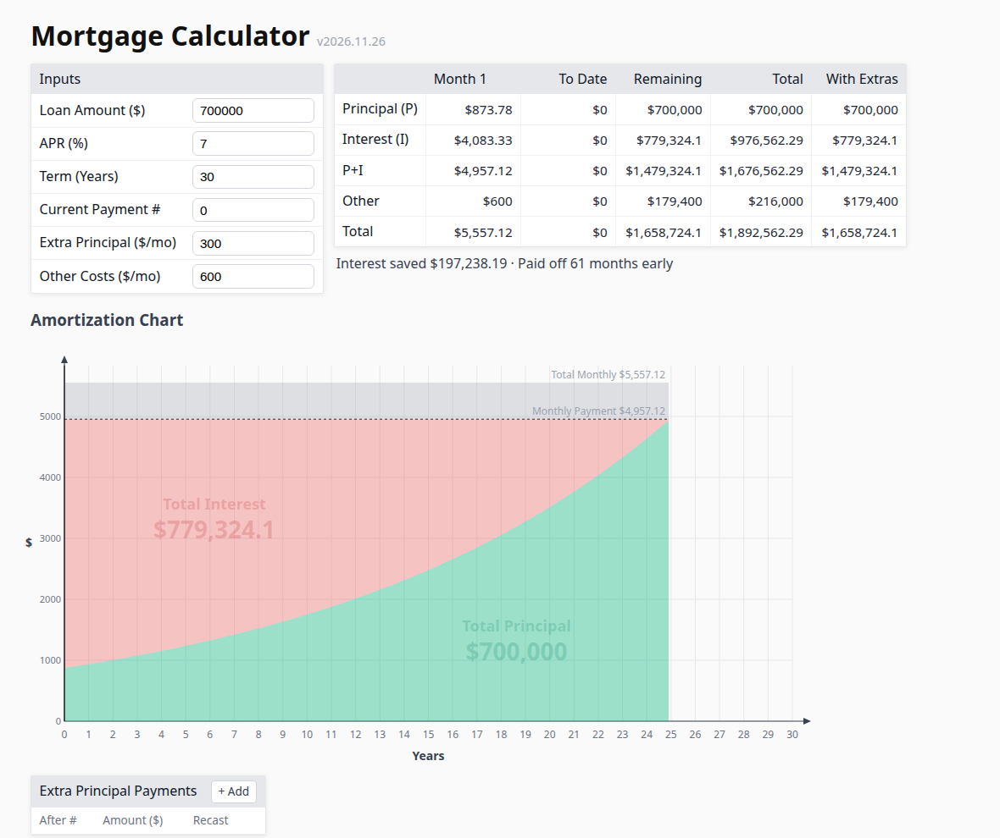

# Mortgage Calculator

An interest loss assessment SPA.

Html/css/js + svg chart. No deps, no building.

**Live:** https://okdzhimiev.github.io/mortgage/?loan=700000&apr=7

## Use
Open `index.html` in any browser. No webserver is needed.

## Features
- **Inputs:** loan amount, APR, term, current payment #, extra principal ($/mo), and other costs ($/mo: escrow, PMI, HOA…).
- **Results table:**
  - **Month N:** the breakdown for the current payment. It follows the mouse when you hover the chart.
  - **To Date / Remaining:** up to the current payment, and from it to the end.
  - **Total:** the plain loan, without extras.
  - **With Extras:** shown when extras are set.
  - **Other and Total rows:** shown when other costs are set.
- **Extra principal payments:**
  - **Recurring:** a monthly extra, starting at the current payment #.
  - **One-off:** lump sums after any payment #, each with an optional **recast**. A recast re-amortizes the balance over the remaining original term, which lowers the payment and keeps the payoff date.
  - **Summary note:** new payment, interest saved, and months paid off early.
- **Amortization chart:**
  - Stacked principal and interest areas, with a grey band for other costs.
  - Labelled monthly-payment levels, including each new level after a recast.
  - Total interest and principal shown inside their areas.
  - A line marking the current payment.
  - **Hover:** shows interest and principal summed from the current payment to the hover point, and from there to payoff. Small markers show each range.
- **Shareable links:** the main inputs are kept in the URL.

## License
Copyright (C) 2026 Oleg Dzhimiev

Licensed under the [GNU Affero General Public License v3.0](LICENSE) or later (AGPL-3.0-or-later).
You may use, modify and share it. If you distribute it or run a modified version as a website, you must release your source under the same license.
